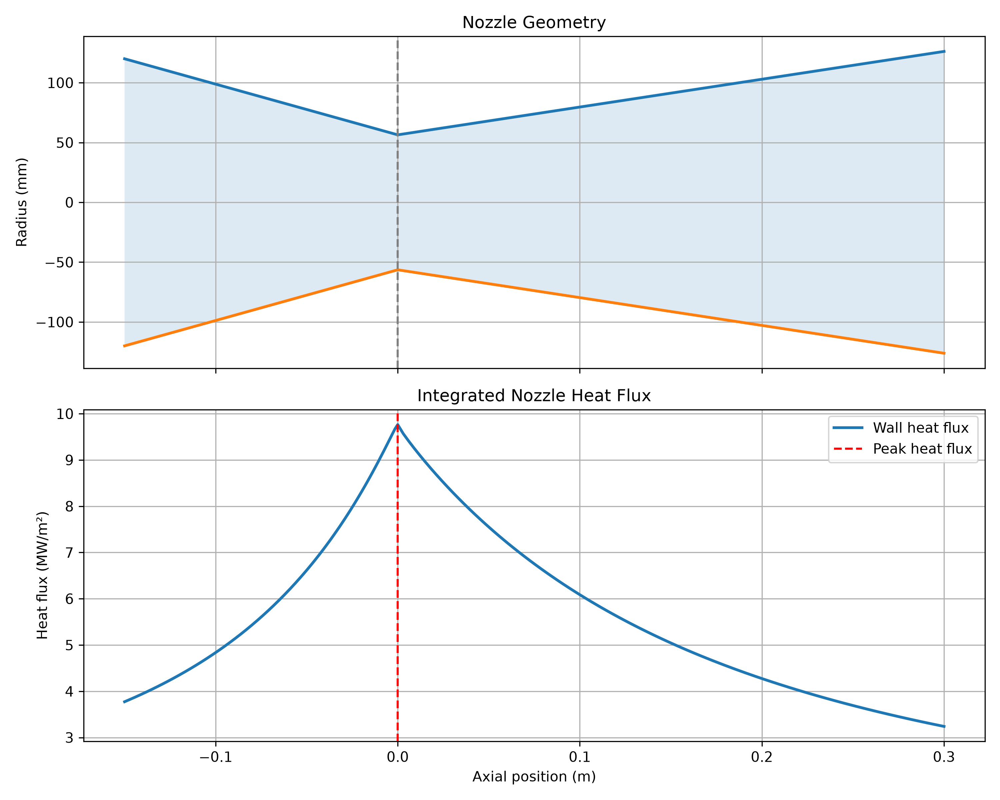
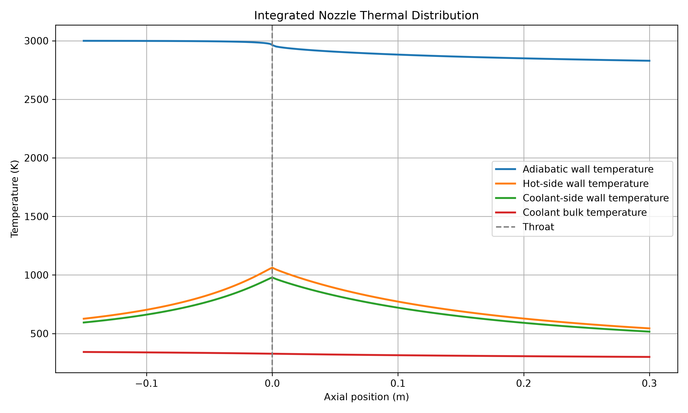
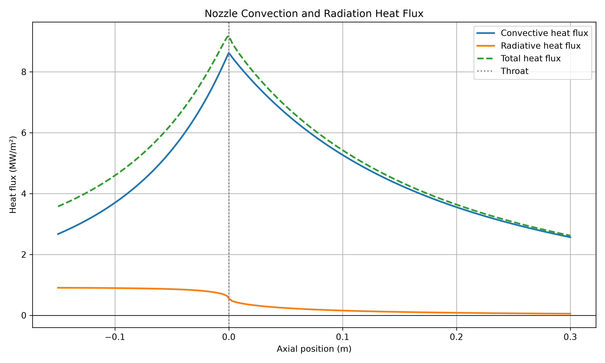
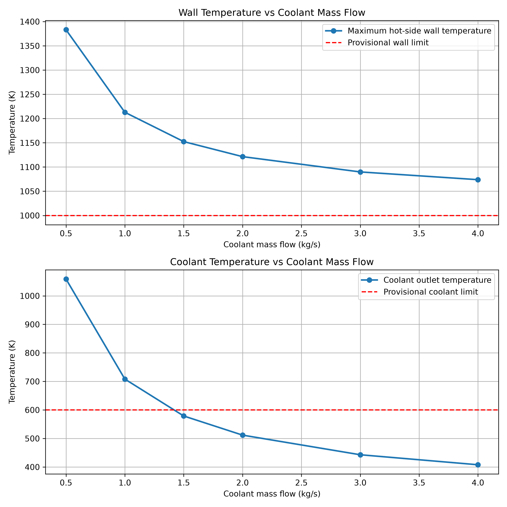

# Rocket Chamber & Nozzle Thermal Model

A Python-based thermal simulation framework for analyzing heat transfer and regenerative cooling in a rocket combustion chamber and converging-diverging nozzle.

This project extends a quasi-one-dimensional nozzle performance simulator with gas-side convection, thermal radiation, wall conduction, coolant heating, and simplified cooling-channel pressure losses.

The framework supports axial thermal analysis, design parameter studies, and numerical verification.

## 1. Project Overview

Rocket combustion chambers and nozzles operate under severe thermal conditions. High-temperature combustion gases transfer energy to the chamber and nozzle walls, requiring effective cooling to maintain acceptable wall temperatures.

Regenerative cooling circulates propellant through channels surrounding the hot-gas passage, allowing the coolant to absorb heat before potentially entering the combustion chamber.

This project models the interaction between:

- Compressible gas flow through a converging-diverging nozzle
- Gas-side convective heat transfer
- Simplified thermal radiation
- Heat conduction through the chamber/nozzle wall
- Coolant-side convective heat transfer
- Axial coolant temperature evolution
- Cooling-channel pressure losses

The model also evaluates how coolant mass flow, coolant-side heat-transfer coefficient, and wall thermal conductivity affect thermal performance.

## 2. Model Architecture

The thermal simulation integrates the nozzle-flow solver developed in Project 1 with additional thermal and coolant-flow models.

```text
Project 1: Nozzle Flow Solver
              |
              v
Nozzle Geometry and Gas Properties
              |
              v
Adiabatic Wall Temperature
              |
              v
Gas-Side Heat-Transfer Coefficient
              |
              v
Convection + Radiation + Wall Conduction
              |
              v
Regenerative Coolant Energy Balance
              |
              v
Wall Temperatures and Coolant Heating
              |
              v
Design Sensitivity and Grid Convergence
```

The integrated model calculates thermal quantities along the nozzle's axial coordinate using the nozzle geometry and local gas-flow properties.


## 3. Governing Equations

### 3.1 Gas-Side Convective Heat Transfer

Convective heat transfer from the gas to the wall is modeled as:

$$
q''_{\mathrm{conv}} = h_g(T_{aw} - T_{w,g})
$$

where:

- $h_g$: gas-side heat-transfer coefficient
- $T_{aw}$: adiabatic wall temperature
- $T_{w,g}$: hot-side wall temperature

The adiabatic wall temperature is approximated using a recovery factor:

$$
T_{aw} = T + r\frac{u^2}{2c_p}
$$

For the turbulent boundary-layer approximation:

$$
r = Pr^{1/3}
$$

The gas-side heat-transfer coefficient is estimated using a simplified Dittus–Boelter-type correlation:

$$
Nu = 0.023Re^{0.8}Pr^{0.4}
$$

$$
h_g = \frac{Nu\,k_g}{D_h}
$$

This correlation is used as an illustrative engineering approximation rather than a validated rocket-nozzle heat-transfer correlation.

### 3.2 Thermal Radiation

A simplified gray-body radiation model is used:

$$
q''_{\mathrm{rad}} =
\epsilon_{\mathrm{eff}}\sigma
(T_{\mathrm{rad}}^4 - T_{w,g}^4)
$$

where:

- $\epsilon_{\mathrm{eff}}$: effective emissivity
- $\sigma$: Stefan–Boltzmann constant
- $T_{\mathrm{rad}}$: effective radiating gas temperature

The model uses local static gas temperature as an illustrative radiation temperature, distinct from the adiabatic wall temperature used for convection.

### 3.3 Wall Conduction

Heat conduction through the wall is represented by:

$$
q''_{\mathrm{wall}} =
\frac{k_w}{L_w}(T_{w,g} - T_{w,c})
$$

where $T_{w,c}$ is the coolant-side wall temperature.

### 3.4 Coolant-Side Convection

$$
q''_{\mathrm{coolant}} =
h_c(T_{w,c} - T_c)
$$

The local thermal balance satisfies:

$$
q''_{\mathrm{conv}} + q''_{\mathrm{rad}}
= q''_{\mathrm{wall}}
= q''_{\mathrm{coolant}}
$$

The nonlinear radiation contribution is resolved using a root-finding solver.

### 3.5 Regenerative Coolant Energy Balance

Coolant heating is calculated from:

$$
\dot{m}_c c_p\,dT_c = q''\,dA_w
$$

The axial coolant temperature is obtained using a segment-by-segment marching method.

Both coflow and counterflow configurations are supported, with the integrated baseline using counterflow.

### 3.6 Nozzle Wall Geometry

The lateral surface area of each nozzle segment is calculated using the conical-frustum approximation:

$$
\Delta A_i =
\pi(r_i+r_{i+1})
\sqrt{(\Delta x_i)^2+(\Delta r_i)^2}
$$

This accounts for changing nozzle radius and wall slope.

## 4. Baseline Simulation Parameters

| Parameter | Value |
|---|---:|
| Chamber pressure | 5 MPa |
| Chamber temperature | 3000 K |
| Specific heat ratio | 1.25 |
| Gas constant | 350 J/(kg·K) |
| Throat area | 0.01 m² |
| Expansion ratio | 5 |
| Coolant inlet temperature | 300 K |
| Coolant mass flow | 2 kg/s |
| Coolant specific heat | 3000 J/(kg·K) |
| Coolant-side heat-transfer coefficient | 15,000 W/(m²·K) |
| Wall thickness | 3 mm |
| Wall thermal conductivity | 350 W/(m·K) |
| Effective radiation emissivity | 0.20 |

The thermal and coolant properties are simplified illustrative inputs, not a fully characterized propellant/material combination.

## 5. Simulation Results

### 5.1 Integrated Thermal Performance

The baseline integrated simulation produces the following results on the original 199-point axial grid.

| Quantity | Result |
|---|---:|
| Coolant inlet temperature | 300 K |
| Coolant outlet temperature | 511.76 K |
| Maximum hot-side wall temperature | 1121.40 K |
| Total absorbed heat | 1270.54 kW |
| Convective heat contribution | 1169.70 kW |
| Radiative heat contribution | 100.83 kW |
| Convective contribution | 92.06% |
| Radiative contribution | 7.94% |

The highest total heat flux occurs near the nozzle throat, where the gas-side heat-transfer coefficient is elevated.

### 5.2 Axial Heat-Flux Distribution



### 5.3 Axial Wall and Coolant Temperatures



### 5.4 Convection and Radiation Contributions



The radiation model predicts a spatial distribution different from that of convection, illustrating the importance of treating the two mechanisms separately.

## 6. Thermal Design Sensitivity Studies

Three parameters were investigated to understand their influence on maximum wall temperature and coolant heating.

### 6.1 Coolant Mass Flow

| Mass flow (kg/s) | Coolant outlet (K) | Maximum wall (K) |
|---|---:|---:|
| 0.5 | 1058.96 | 1383.13 |
| 1.0 | 708.17 | 1212.88 |
| 1.5 | 578.88 | 1152.42 |
| 2.0 | 511.76 | 1121.40 |
| 3.0 | 442.93 | 1089.85 |
| 4.0 | 407.86 | 1073.87 |

Increasing coolant mass flow decreases coolant temperature rise and reduces maximum wall temperature.

However, the coolant-side heat-transfer coefficient is held constant during this sweep, so the study does not capture the coupled effects of coolant velocity, Reynolds number, and pressure loss.



### 6.2 Coolant-Side Heat-Transfer Coefficient

| \(h_c\) (W/m²·K) | Maximum wall (K) |
|---|---:|
| 5,000 | 1719.56 |
| 10,000 | 1317.89 |
| 15,000 | 1121.40 |
| 20,000 | 1005.03 |
| 30,000 | 873.53 |
| 50,000 | 755.40 |

Increasing the coolant-side heat-transfer coefficient substantially decreases wall temperature.

Under the model's provisional 1000 K wall-temperature criterion, the first tested passing value is 30,000 W/(m²·K).

### 6.3 Wall Thermal Conductivity

| \(k_w\) (W/m·K) | Maximum wall (K) |
|---|---:|
| 20 | 1743.89 |
| 50 | 1408.27 |
| 100 | 1252.60 |
| 200 | 1162.77 |
| 350 | 1121.40 |
| 500 | 1104.33 |

Increasing thermal conductivity reduces wall temperature, but the improvements diminish as wall conduction resistance becomes small relative to coolant-side convection resistance.

### 6.4 Thermal Design Constraints

Illustrative limits were introduced to demonstrate thermal constraint evaluation:

- Maximum allowable hot-side wall temperature: 1000 K
- Maximum allowable coolant temperature: 600 K

For the baseline model:

| Constraint | Margin | Result |
|---|---:|---|
| Hot-side wall temperature | −121.40 K | Fail |
| Coolant temperature | +88.24 K | Pass |

These are demonstration targets and should not be interpreted as validated material or coolant operating limits.

## 7. Numerical Verification

### 7.1 Automated Tests

The project includes 23 automated tests covering:

- Thermal resistance calculations
- Local and axial energy conservation
- Radiation balance
- Coolant-flow calculations
- Nozzle wall geometry
- Integrated cooling calculations

Run the tests using:

```bash
python -m pytest -v
```

### 7.2 Grid Convergence

The axial coolant-marching model was evaluated using progressively refined grids.

| Axial points | Coolant outlet (K) | Maximum wall (K) |
|---|---:|---:|
| 199 | 511.7559 | 1121.3994 |
| 397 | 511.9708 | 1121.7073 |
| 793 | 512.0784 | 1121.8613 |
| 1585 | 512.1322 | 1121.9383 |

The differences between successive solutions decrease approximately by a factor of two when the axial segment count is doubled, consistent with first-order numerical convergence.

Richardson extrapolation gives:

| Quantity | Extrapolated value | Estimated finest-grid error |
|---|---:|---:|
| Coolant outlet temperature | 512.1861 K | 0.053836 K |
| Maximum wall temperature | 1122.0153 K | 0.077010 K |

These estimates characterize discretization error in the refined coolant-marching calculation using interpolated gas-side fields.

They do not establish the accuracy of the underlying physical correlations or full nozzle-flow model.

## 8. Project Structure

```text
rocket-thermal-model/
├── project1/
│   └── nozzle_simulator.py
├── results/
├── tests/
│   ├── test_thermal_resistance.py
│   ├── test_axial_thermal.py
│   ├── test_coolant_flow.py
│   ├── test_nozzle_wall_geometry.py
│   ├── test_geometry_cooling.py
│   └── test_separated_radiation.py
├── axial_thermal.py
├── coolant_flow.py
├── design_constraints.py
├── gas_heat_transfer.py
├── grid_convergence.py
├── heat_transfer_sensitivity.py
├── integrated_thermal.py
├── mass_flow_sensitivity.py
├── nozzle_interface.py
├── nozzle_wall_geometry.py
├── thermal_radiation_separated.py
├── thermal_resistance.py
├── validation_report.py
├── requirements.txt
├── pytest.ini
├── .gitignore
└── README.md
```

## 9. Installation and Usage

### Requirements

- Python 3
- NumPy
- SciPy
- Matplotlib
- pytest

Install dependencies from the project directory:

```bash
python -m pip install -r requirements.txt
```

Run the integrated thermal simulation:

```bash
python integrated_thermal.py
```

Run the automated test suite:

```bash
python -m pytest -v
```

Generated figures are saved in the `results/` directory.

## 10. Assumptions and Limitations

The simulation is intended as an educational engineering model and preliminary thermal-analysis framework.

Its principal limitations include:

- Quasi-one-dimensional, idealized nozzle-flow assumptions
- Simplified gas-side convective heat-transfer correlation
- Approximate gray-body radiation treatment
- Constant or prescribed thermophysical properties
- Prescribed coolant-side heat-transfer coefficient
- Simplified cooling-channel geometry and pressure-loss treatment
- No detailed temperature-dependent material behavior
- No structural stress, creep, or thermal-fatigue analysis
- No coolant phase-change, boiling, or coking model
- No experimental calibration or validation against high-fidelity CFD

The numerical verification results demonstrate internal consistency and discretization convergence for selected calculations, not full physical validation.

## 11. Future Improvements

Potential extensions include:

- Bartz-type rocket nozzle heat-transfer correlations
- Temperature-dependent gas and coolant properties
- Coupled coolant pressure-drop and heat-transfer calculations
- Temperature-dependent wall conductivity
- Detailed regenerative cooling-channel geometry
- Thermomechanical stress analysis
- Comparison with experimental or higher-fidelity simulation data

## 12. Related Project

**Project 1 — Rocket Nozzle Performance Simulator**

[View Project 1 on GitHub](https://github.com/jonathancheng9200-cell/rocket-nozzle-simulator)

The nozzle-flow solver developed in Project 1 provides the geometry and gas-flow conditions used by this thermal model.

---

**Project Type:** Independent Aerospace Engineering Simulation

**Focus Areas:** Rocket Propulsion, Heat Transfer, Regenerative Cooling, Numerical Methods, Python